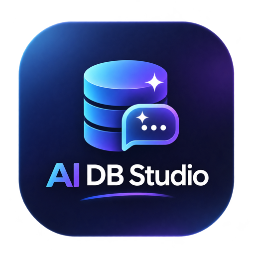
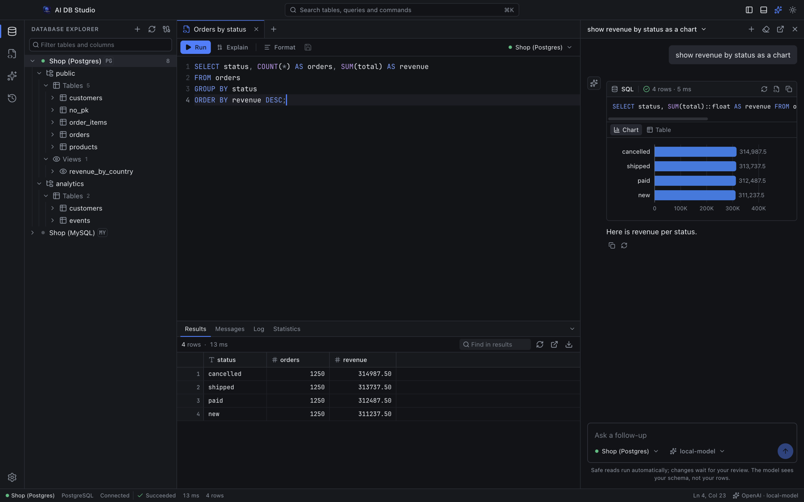
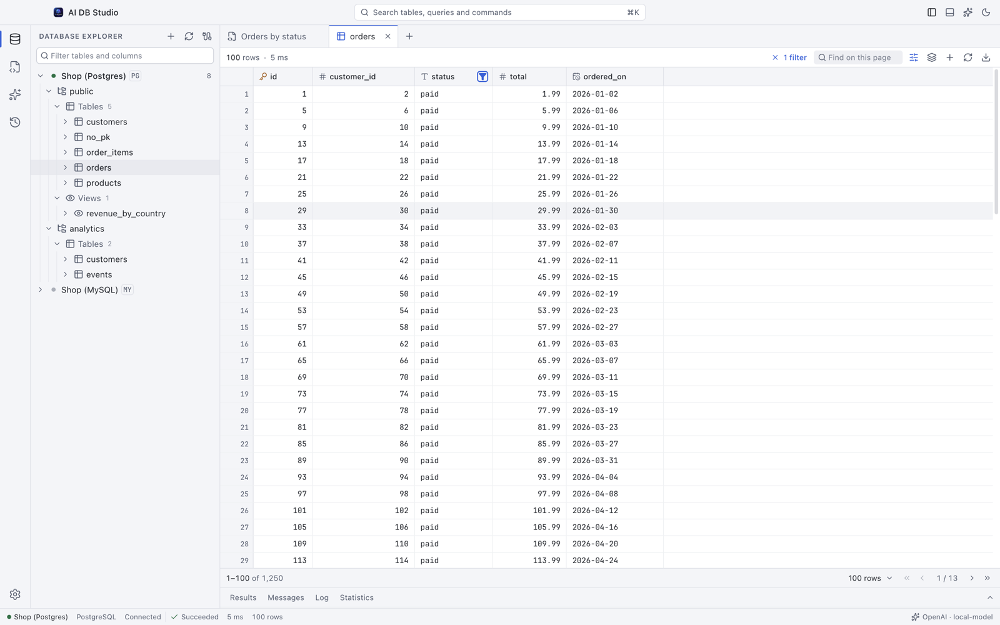
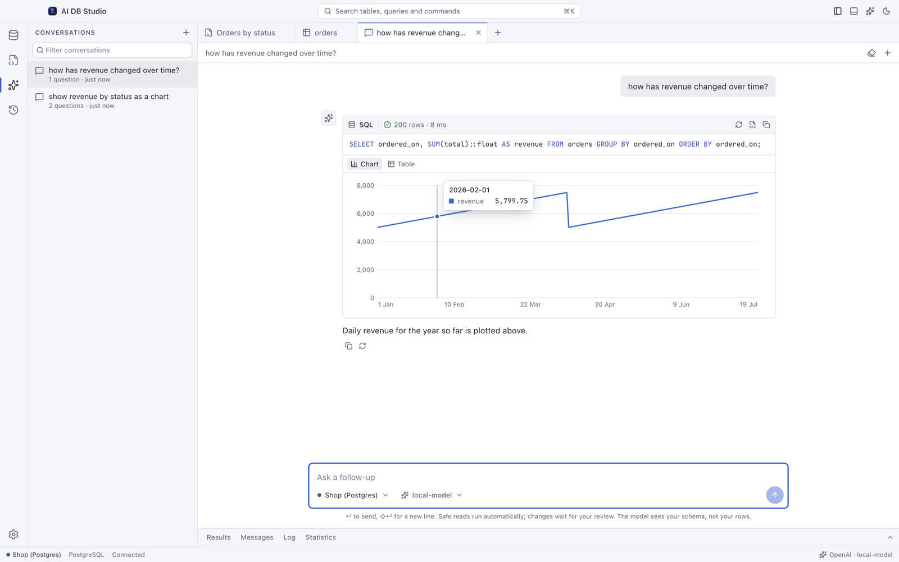
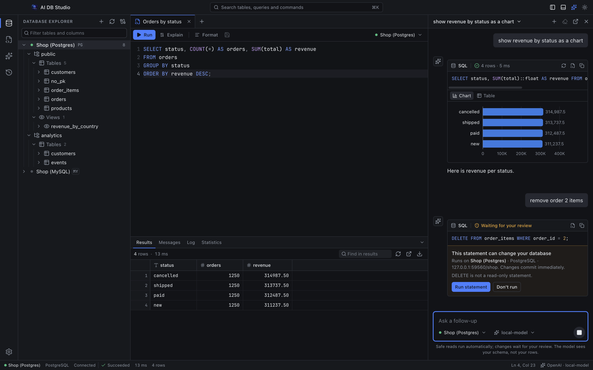

<p align="center">
  
</p>

<h1 align="center">AI DB Studio</h1>

<p align="center">
  <strong>A desktop database client for PostgreSQL and MySQL, with an AI assistant that can't change your data without your approval.</strong>
</p>

<p align="center">
  <a href="LICENSE"></a>
  
  
  
</p>

<p align="center">
  <a href="#get-started">Get started</a> ·
  <a href="#connect-an-ai-model">Connect an AI model</a> ·
  <a href="#how-the-assistant-stays-safe">Safety</a> ·
  <a href="#keyboard-shortcuts">Shortcuts</a> ·
  <a href="#known-limitations">Limitations</a> ·
  <a href="#development">Development</a>
</p>



Write SQL by hand, or ask in plain language. AI DB Studio keeps both in one window: browse your schema, run queries and edit data in the workbench, and keep the assistant open beside it.

The assistant runs safe read queries on its own and shows you the results. Anything that could change your data stops and waits for you to approve that exact statement. By default it sees your schema but not your rows, and it can run on a local model through Ollama.

## Features

### Database workbench

- **SQL editor:** Monaco with syntax highlighting, completions for your tables and columns (including aliases), formatting, run selection, Explain and query cancellation.
- **Results grid:** virtualized rendering, with column resizing, sorting, per-column filters, row selection, keyboard navigation, and copy or export to CSV and JSON.
- **Table data:** page, sort and filter on the server, and insert, edit or delete rows after reviewing the generated SQL.
- **Table structure:** columns, indexes, foreign keys, constraints, size and DDL for every table.
- **Schema explorer:** connections, schemas, tables, views, columns, keys and indexes in one searchable tree, with full keyboard support.
- **Workspace:** draggable tabs, a results panel with logs and statistics, query history, a command palette, and dark and light themes. Your layout and open tabs are restored when you reopen the app.



### AI assistant

- **Conversation:** it answers in the language you write in, including mixes such as Hinglish, and asks when a request is unclear.
- **Memory:** each conversation is remembered across restarts, so follow-ups like "same but for last month" work. Long conversations are summarized automatically.
- **Runs queries for you:** read queries run automatically, and results appear as a table, chart or single number.
- **Fixes its own mistakes:** when a query fails, it reads the error and tries a corrected one.
- **Two ways to use it:** a full tab, or a panel beside your work (`⌘L`). Both share the same conversations.
- **Your choice of model:** Ollama, OpenAI or any OpenAI-compatible endpoint, built on [LangChain](https://js.langchain.com). If the model can't be reached, a small built-in engine still answers simple reads.



## Get started

### Install

Download an installer from [GitHub Releases](https://github.com/substring-projects/ai-db-studio/releases) if one is available for your platform, or build one yourself:

```bash
git clone https://github.com/substring-projects/ai-db-studio.git
cd ai-db-studio
npm ci
npm run dist:mac   # or: npm run dist:win
```

Installers are written to `release/`. They aren't code-signed yet, so macOS and Windows will warn you the first time you open the app.

### Connect to a database

1. Click **+** in the Database Explorer.
2. Enter your connection details and click **Test connection**.
3. Click the connection in the tree to connect and browse it.

**TLS:** use **Disable** for a local server without TLS, because **Prefer** and **Require** both need the server to support it. See [Known limitations](#known-limitations) for how certificates are handled.

## Connect an AI model

Open **Settings** (`⌘,`) and choose a provider. Use a model that supports **tool calling** for the best results: the assistant then chooses which queries to run and can look up table definitions.

**Ollama (runs on your machine)**

```bash
ollama pull llama3.1
```

Set the provider to **Ollama**, the endpoint to `http://localhost:11434` and the model to `llama3.1`.

**OpenAI or a compatible service**

Set the provider to **OpenAI or compatible**, then enter the endpoint, model (for example `gpt-4o-mini`) and API key.

Models without tool calling still work: the assistant falls back to writing SQL in its replies, with the same safety checks.

## How the assistant stays safe

| What the assistant writes | What happens |
| :--- | :--- |
| A safe read: `SELECT`, `SHOW`, `DESCRIBE`, `EXPLAIN` | Runs automatically in a read-only transaction, with a 30-second limit |
| A change: `INSERT`, `UPDATE`, `DELETE`, schema changes | Waits on a review card showing the SQL and target database, and runs only if you approve |
| A destructive change: `DROP`, `TRUNCATE`, or `DELETE`/`UPDATE` with no `WHERE` | Same review card, plus a required "I understand this cannot be undone" checkbox |
| A read with side effects: `pg_sleep`, `nextval`, `FOR UPDATE` | Also goes to review |



- **The model can only propose.** The app holds the statement, and only your click can release it.
- **An approval covers one statement.** It is single-use and tied to that exact SQL and connection.
- **Hidden statements are caught.** Scripts like `SELECT 1; DROP TABLE x` go to review like any other write.
- **The database enforces reads.** Automatic queries run in a read-only transaction, so the database itself refuses writes.
- **Your own SQL gets the same protection.** Anything you write that changes data asks for confirmation first.

To review every query, including reads, turn off **Run safe read queries automatically** in the chat's model menu.

### What the AI model can see

| Sent to the model | Default | With "Let the model read query results" on |
| :--- | :--- | :--- |
| Your messages and the conversation so far | Yes | Yes |
| Table and column names, types, keys and indexes | Yes | Yes |
| The SQL it wrote, and any database errors | Yes | Yes |
| Row counts and column names of results | Yes | Yes |
| Result rows | **No** | Up to 50 rows per result |
| Database passwords | **No** | **No** |

With sharing off, the assistant can't quote values from your data; it points you to the results shown under its message. Turn sharing on for answers like "you have 300 customers", ideally with a local model, because the rows go to whichever endpoint you configured. Rows are never saved in conversation memory either way.

Error messages come from your database and can occasionally include a value, such as MySQL's duplicate-key error.

## Keyboard shortcuts

On Windows, use `Ctrl` in place of `⌘`.

| Shortcut | Action |
| :--- | :--- |
| `⌘ Enter` | Run the selection, or the whole query |
| `⌘ ⇧ Enter` | Run the whole query |
| `⌘ E` | Explain |
| `⇧ ⌥ F` | Format SQL |
| `⌘ S` | Save the query |
| `⌘ T` | New query |
| `⌘ W` | Close tab |
| `⌃ Tab` | Next tab |
| `⌘ K` | Command palette |
| `⌘ B` | Toggle the sidebar |
| `⌘ J` | Toggle the bottom panel |
| `⌘ L` | Toggle the AI panel |
| `⌘ ⇧ L` | New AI conversation |
| `⌘ 1` to `⌘ 4` | Explorer, SQL Editor, AI Assistant, Query History |
| `⌘ ,` | Settings |

## Compatibility

| | Status |
| :--- | :--- |
| **PostgreSQL** | Tested with version 17 |
| **MySQL** | Tested with version 8.4 |
| **Other versions, MariaDB, cloud-hosted databases** | Not tested. They may work, but aren't verified yet |
| **macOS** | Developed and tested on macOS |
| **Windows** | Installers are configured, but this version hasn't been tested on Windows |
| **Linux** | No installer is configured, and it hasn't been tested |

## Where your data is stored

Everything stays on your computer, in the app's data folder (on macOS, `~/Library/Application Support/AI DB Studio`, or `ai-db-studio` when running from source).

| File | Contents |
| :--- | :--- |
| `studio-storage.json` | Connections, saved queries, query history and settings. Passwords and the AI API key are **encrypted with your system's keychain** |
| `ai-memory.json` | Conversation memory: messages and the SQL that ran, never result rows |
| Browser storage in the app | Layout, open tabs and the conversations shown in the chat, without result rows |

Apart from passwords and the API key, these files aren't encrypted, so saved queries, history and conversations are readable by anyone with access to your user account. The two JSON files are readable only by your user.

If your system has no secure storage, such as Linux without a keyring, passwords aren't saved at all and you'll enter them again after quitting. On macOS, the system may ask for permission to use the keychain the first time.

## Known limitations

AI DB Studio is pre-release software. Before using it with production databases, please note:

- **Saved queries, history and conversations aren't encrypted.** Queries you save can contain sensitive values.
- **TLS certificates aren't verified.** Traffic is encrypted, but the app doesn't confirm the server's identity, so it wouldn't detect a man-in-the-middle attack on an untrusted network.
- **Row limits:** results keep the first 100,000 rows for your queries and 5,000 for AI queries. The limit applies after the database returns them, so a very large query still uses a lot of memory.
- **Export** on a table tab covers the current page only.
- **Chat:** a reply you stop while it's streaming isn't saved to memory, and conversations don't share memory with each other.
- **Small windows:** when space runs out the left sidebar can close automatically. Press `⌘B` to reopen it.

## Development

Requires Node.js 22.18 or newer.

```bash
npm ci
npm run dev         # Run the app with hot reload
npm test            # Unit tests
npm run typecheck   # TypeScript checks
npm run build       # Production build
```

### Project layout

```text
src/
├── main/                   Electron main process
│   ├── main.ts             Window, menu and IPC handlers
│   └── services/
│       ├── ai/             LangChain agent, conversation memory, review flow
│       ├── ConnectionManager.ts   Connections, queries, cancellation, metadata
│       ├── SqlClassifier.ts       Decides what is read-only
│       └── StorageService.ts      Local settings and saved data
├── preload/                The typed bridge between main and renderer
├── renderer/               React interface
│   ├── components/
│   │   ├── shell/          Title bar, sidebars, tabs, panels, status bar
│   │   ├── Workbench/      Editor, results grid, table views, explorer
│   │   ├── ai/             Chat, SQL blocks, review card, charts
│   │   └── ui/             Shared components built on Radix
│   ├── context/            Application state
│   └── lib/                SQL, grid, chart and Monaco helpers
└── shared/                 Types shared across processes
test/                       Unit tests
```

Built with Electron, React 19, TypeScript, Tailwind CSS, Radix UI, Monaco Editor, TanStack Table and LangChain.

## Contributing

See [CONTRIBUTING.md](CONTRIBUTING.md). To report a security problem, follow [SECURITY.md](SECURITY.md) rather than opening a public issue.

## License

Licensed under the [Apache License 2.0](LICENSE). Third-party licenses are listed in [THIRD_PARTY_NOTICES.md](THIRD_PARTY_NOTICES.md).
